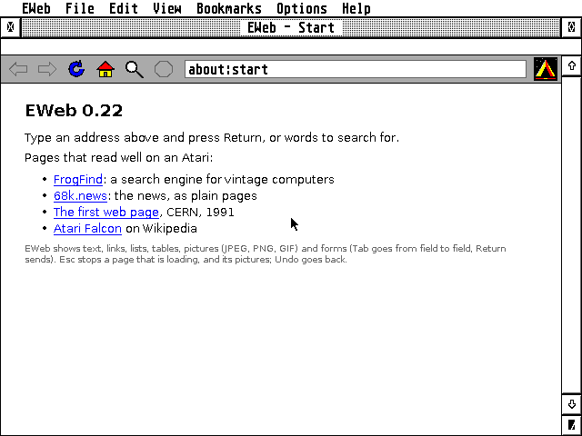

# EWeb


A web browser for the Atari Falcon and TT, written for GEM and tuned for a Falcon with a DFB1
accelerator; its ST edition runs on an ST or STE with 4 MB.

**Highlights**

- **Modern pages:** EWeb's own fast HTML, CSS and layout engines: flexbox, grid, tables, frames.
- **Pictures:** JPEG, PNG, GIF, WebP and SVG, JPEGs decoded on the DSP, dithered to any screen.
- **Forms and JavaScript:** logins, file uploads, cookies; scripts on the sites you choose.
- **Secure sites:** TLS 1.2 on the Atari itself, the DSP doing the maths.
- **Translation:** pages translated into your language on your own Gateway.
- **Hebrew:** pages right to left in every Hebrew encoding, and typing Hebrew (F10).
- **Browsing:** several windows, address-bar search, bookmarks, history, find, a disk cache.
- **File downloads:** files of any size saved straight to disk as they come; pages saved too.
- **Every screen:** monochrome to true colour (the Falcon's, or a graphics card's 24 and 32 bits), in EWeb's own fonts.
- **AERA family:** the family's menus, shortcuts, dialogs and help; mail links open EMail.



## Getting started

Download the latest `eweb-x.y.zip` from **[Releases](../../releases/latest)** and unpack it into a
folder of its own.

| File | What it is |
|---|---|
| `EWEB.PRG` | the browser, for the Falcon and TT |
| `EWEBST.PRG` | the ST edition, for an ST or STE |
| `EWEB.FNT` | the fonts |
| `EWEBJS.OVL` | JavaScript (needs an FPU) |
| `TLS.OVL`, `CACERT.PEM`, `ROOTS.DAT` | secure connections made on the Atari |
| `EWEB.HYP` | the guide (the Help key) |
| `icons/` | the desktop icon |

1. With STinG or MiNTnet running, double-click `EWEB.PRG` (`EWEBST.PRG` on an ST).
2. Type an address and press Return, or pick a site from the home page.
3. Press **Help** for the guide.

**Needs:** a Falcon or TT with about 3.5 MB free and a screen 640 pixels wide, under TOS, EmuTOS
or MagiC; scripts need an FPU. The ST edition needs 4 MB and the Gateway for secure sites.

**Under TOS, put Atari's `FOLDR100.PRG` first in `AUTO`** (renamed `FOLDR400.PRG`), so TOS doesn't
run out of folder memory. **With STinG, set the Delay in `STING.CPX`** to 10 on a Falcon or TT.

## The Gateway

`EWEB.PRG` reaches every site itself. **[AERA-Gateway](https://github.com/whomper/AERA-Gateway)**,
a small service on a Raspberry Pi or in Docker, adds what an Atari can't do alone: secure sites for
the ST edition, translation, the Gateway's own browser for pages made by scripts or CAPTCHAs, and
pictures made smaller. On a Falcon or TT it is optional (Settings > Secure). Its setup is in the
[Gateway's README](https://github.com/whomper/AERA-Gateway#readme); how EWeb uses it, in
[`docs/GATEWAY.md`](docs/GATEWAY.md).

## Building

```sh
sudo apt install gcc-m68k-linux-gnu python3 perl gperf fonts-dejavu-core fonts-dejavu-extra
pip install -r tools/requirements.txt
make            # binary/: EWEB.PRG, EWEBST.PRG, EWEB.FNT and the rest
make test       # the tests, with AddressSanitizer and UBSan
make dist       # dist/eweb-x.y.zip, as on the Releases page
```

The other targets are in [`docs/TESTS.md`](docs/TESTS.md). A release is `tools/bump.py`, a commit
to `main`, then **Actions > Release > Run workflow**.

## Source

```
ui/              the GEM side: window, toolbar, menus, dialogs
src/             the browser: loading, HTML, CSS, layout, pictures, SVG, JavaScript, network
tests/           the tests and the measuring tools
docs/            the design (DESIGN.md), the guide (GUIDE.md), the full list (SOURCE.md)
common/          the AERA family's shared code (from AERA-Atari: don't edit here)
```

## Tests

`make test` runs the tests on this computer; every other check is in [`docs/TESTS.md`](docs/TESTS.md).

## Licence

EWeb is free software under the GNU General Public License, version 2 or (at your option) any
later version; see [`COPYING`](COPYING). Copyright (C) 2026 AERA | Erez Yaary.

`EWEB.FNT` is drawn from the DejaVu fonts (Bitstream Vera's licence). NetSurf's libraries,
QuickJS, musl's maths and BearSSL are under the MIT licence; libjpeg-turbo under the IJG's and
BSD licences; TJpgDec under ChaN's licence; `CACERT.PEM` is Mozilla's (MPL 2.0).

---

Part of **AERA** for Atari: [ECal](https://github.com/whomper/ECal) · [EContact](https://github.com/whomper/EContact) · [EMail](https://github.com/whomper/EMail) · [EFTP](https://github.com/whomper/EFTP) · [EHypView](https://github.com/whomper/EHypView) · [ClaudeST](https://github.com/whomper/ClaudeST) · [EWeb](https://github.com/whomper/EWeb) · [EUpdate](https://github.com/whomper/EUpdate) · [EPDF](https://github.com/whomper/EPDF) · 8-bit: [EDOS](https://github.com/whomper/EDOS) · [EFTP_XL](https://github.com/whomper/EFTP_XL) · Gateway: [AERA-Gateway](https://github.com/whomper/AERA-Gateway)
