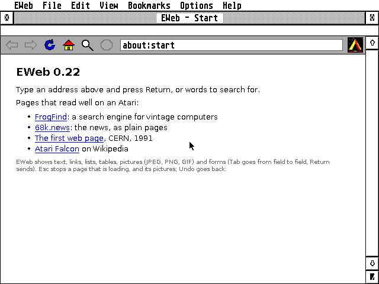

# EWeb


A web browser for the Atari Falcon and TT, written in C for GEM, made for a
Falcon with a DFB1 accelerator (68030 at 50 MHz, FPU, 128 MB of TT-RAM) and
fine on any Falcon or TT; its ST edition runs on an ST or STE with 4 MB. It
shows the document web: pages laid out with their stylesheets, links, lists,
tables, pictures and forms, with cookies and a little JavaScript, in EWeb's
own fonts.



## Highlights

- **`EWEB.PRG`**: one GEM window, as a browser has it: Back, Forward,
  Reload, Home, Search and Stop, the address, the AERA throbber turning
  while a page comes, and a status bar whose line fills as it loads; links
  followed with a click, scrolling with the slider and the keys, 50 pages of
  history, the page's text to the clipboard, larger and smaller text. Words
  typed in the address go to FrogFind, the search engine made for vintage
  computers (Settings > General for another). A page that sends you on
  (`<meta http-equiv=refresh>`, the Refresh header) goes on when its time
  comes, as the status line says; Esc stays.
- **EWeb's own engine**: EWeb's HTML parser (the HTML Standard's, nearly three
  times as fast as NetSurf's on the 68030), EWeb's CSS engine
  (about a tenth of LibCSS's time on the 68030, [`docs/CSS.md`](docs/CSS.md);
  a sheet for print or another width, by its `media`, left out)
  and fresh layout code: blocks, lines, lists, floats, tables, flexbox and
  grid, colours (translucent ones and opacity too, mixed with what is under
  them in every screen mode), borders, background pictures, colour
  gradients (linear, radial and conic, dithered to the screen's colours;
  the ST edition draws those that run straight down or across, in the
  screen's own colours, and any other in its colours' average), the old
  centring (`<center>`, `align`), and Hebrew right to left, in every Hebrew
  encoding (visual Hebrew, ISO-8859-8, shown in the order it is stored, as
  browsers show it): a page that names none is read as browsers read it
  (UTF-8 when it is, Windows-1255 on Israeli sites), and View > Encoding
  reads one again in another. The parts a page folds away (`<details>`)
  open and close with a click.
- **Pictures**: JPEG (libjpeg-turbo, every kind), PNG with transparency and
  GIF, fetched after the page is shown (you read and scroll meanwhile),
  decoded straight at the size shown, dithered to the screen's colours in
  monochrome, 4, 16 and 256 colours (on a Falcon the DSP decodes the JPEGs
  and, in 4 colours or more, dithers them, about eight times as quick as the
  68030); of a picture offered in several sizes and forms (`srcset`,
  `<picture>`), the one the screen needs; off with one menu item on a slow
  line.
  The decoders are the family's (AERA-Atari's `common/src/pic.c`).
- **Forms**: fields, boxes, lists and buttons, typed into (Hebrew too,
  right to left), Tab from one to the next and Return to send; sent with
  GET or POST, urlencoded, multipart or plain text, in the page's own
  character set, as the HTML Standard has browsers send them (files can't
  be sent yet: a file field sends none).
- **A little JavaScript** (QuickJS, on a lean DOM of EWeb's own document):
  menus, tabs, form checks, alerts, timers and `fetch`, for the sites you
  choose (Options > Run this site's scripts), within a budget of 200 KB and
  a few seconds a page; past it, or with scripts off, the page's
  `<noscript>` version. It needs an FPU (a 68881 or 68882, as on the DFB1):
  without one, and in the ST edition, pages are shown without scripts.
- **Cookies**, as RFC 6265bis has them, those meant to last kept in
  `COOKIES.TXT` (written once, at quit; their values encrypted, as the
  family keeps passwords); none for other sites' pictures and
  stylesheets; Options > Forget cookies.
- **Bookmarks**: a Bookmarks menu (^D adds the page shown, ^B shows them all
  as a page), kept in `BOOKMARK.HTM` in the bookmark file other browsers
  import and export.
- **A disk cache**, as HTTP has browsers keep one: pages, stylesheets and
  pictures kept in one pack (`CACHE\EWEB.PAK`) from one run to the next,
  asked again with their ETag or date when they say so, and pictures kept
  decoded for the screen (a page of pictures in a quarter of a second
  instead of twenty); a kept page shown when its site can't be reached;
  Settings > General for its size, Options > Empty the cache.
- **Saving**: the page shown as it came (^S), a link's file (Alternate-click,
  as Safari's Option-click, or a link marked as a download) straight to the
  disk as it comes, and a file EWeb doesn't show (a ZIP, a program, a PDF),
  or one its site says to save, saved where you say when you open its link;
  under the name the site gives it (RFC 6266), made to fit a TOS disk,
  archives as they came.
- **EWeb's own fonts** (`EWEB.FNT`): DejaVu Sans, Serif and Mono in four
  styles and twelve sizes, the same on every Atari, with or without GDOS.
- **Every screen**: monochrome, 4, 16 and 256 colours and the Falcon's true
  colour, through ST-RAM so that it runs from TT-RAM.
- **Secure sites itself**: TLS 1.2 on the Atari, the arithmetic on the DSP
  (Falcon mode); or through the Pi gateway, AERA-Gateway's web service on a
  Raspberry Pi (TLS 1.3 sites too).
- **The family's ways**: the About box, menus, shortcuts, right-click menus,
  VA_START and drag and drop, the help file, iconify, the crash report; a
  mail address (`mailto:`) goes to EMail.
- And the first milestone's tools: `NSBENCH.TTP` times NetSurf's HTML parser
  (Hubbub) and both CSS engines (LibCSS and EWeb's) on the Atari,
  `PICBENCH.TTP` a JPEG decoded and dithered on the 68030 and with the DSP,
  `EWGET.TTP` fetches a page and times it.
  [`docs/DESIGN.md`](docs/DESIGN.md) has what was measured, the decisions
  and the plan.

## Getting started

Download the latest `EWEB-x.y.zip` from **[Releases](../../releases/latest)**
and unpack it into a folder of its own. It contains:

| File | What it is |
|---|---|
| `EWEB.PRG` | the browser, for the Falcon and TT |
| `EWEBST.PRG` | the ST edition: 68000 code, secure sites through AERA-Gateway's web service on a Raspberry Pi |
| `EWEB.FNT` | its fonts (keep it next to `EWEB.PRG`) |
| `EWEB.HYP` | the guide, for EHypView or ST-Guide (the Help key opens it) |
| `CACERT.PEM`, `ROOTS.DAT` | the authorities that vouch for secure sites (Mozilla's list) |
| `icons/` | EWeb's desktop icon: `EWEB.RSC` (black and white for TOS 1 and 2, and in colour, 16 and 256 colours, to copy into `DESKICON.RSC` and `DESKCICN.RSC` with a resource editor), `EWEB.ICN` and its mask `EWEBMK.ICN` |
| `NSBENCH.TTP`, `NSBENCH.TXT`, `SAMPLE.HTM`, `NEWS.HTM`, `NEWS.CSS` | the measuring tool, its guide and two pages to try it on |
| `PICBENCH.TTP`, `PICBENCH.TXT`, `PHOTO.JPG` | times a JPEG on the 68030 and with the DSP, its guide and a photo to try it on |
| `EWGET.TTP`, `EWGET.TXT` | fetches a page and times it, and its guide |

1. With STinG running, double-click `EWEB.PRG` (`EWEBST.PRG` on an ST or
   STE). Its start page has a few sites that read well on an Atari.
2. Click in the address (or press ^L), type one such as `68k.news` and press
   Return. Click a link to follow it; Undo goes back.
3. Pages on your disks open too: ^O, or drop one on `EWEB.PRG`.

**Needs:** a Falcon or TT, plain TOS, EmuTOS or MagiC, a screen 640 pixels
wide, about 3 MB free (the program itself takes 2.2 MB; big pages more);
STinG or MiNTnet for the network. On an ST or STE (TOS 1.04 or newer, with
4 MB), the ST edition `EWEBST.PRG`, with the Pi gateway's address
in Settings > Secure.

**Under TOS, put Atari's `FOLDR100.PRG` first in `AUTO`**, renamed for more room (`FOLDR400.PRG`).
TOS keeps an entry in a small internal pool for every folder a program or accessory has looked
into, and halts with "OUT OF INTERNAL MEMORY" when it runs out; FOLDRxxx makes the pool bigger.

**With STinG, set the Delay in `STING.CPX` to suit the machine:** 10 on a Falcon or TT, 25 to 50
on an ST, as STinG's manual says. STinG looks at the network card that often, so it sets the speed
of every STinG program: on Erez's Falcon with a NetUSBee, Delay 10 took EFTP's downloads from 40 to
75 KB/s, and pages come the faster for it too. On a NetUSBee, keep STinG's TCP receive window at
5840 (MSS 1460): the card holds about four full packets.

## How it reaches the servers

```
ST, STE:     Atari (EWEBST.PRG) --plain HTTP, home LAN--> Raspberry Pi (webgate.py) --HTTP or HTTPS--> the site
Falcon, TT:  Atari (EWEB.PRG, TLS 1.2, RSA and curves on the DSP) --------------------HTTP or HTTPS--> the site
```

Straight from the Atari, through STinG or MiNTnet: EWeb resolves the name
and connects itself, and for `https://` does TLS 1.2 on the 68030
(BearSSL, ChaCha20-Poly1305 first, which is twice as fast as AES there),
with the server's RSA or ECDSA signatures and the key exchange worked out
on the DSP: on Erez's DFB1 a handshake with Wikipedia's ECDSA certificates
took 8 s the first time and about 3 s after (signatures once checked are
kept in `SIGS.DAT`), where the 68030 alone had taken 86 s. A TT, which has
no DSP, does it all on its 68030, so there the Pi gateway is the quicker
way. Every certificate is checked against the authorities in `CACERT.PEM`
(Mozilla's list; `ROOTS.DAT` is the same list read in advance), with its
name and dates; there is no way to skip the check. A kept connection serves
the next requests to the same server, and a new one to it resumes the TLS
session, which saves most of the handshake.

Or through the Pi gateway (its address in Settings > Secure, with Falcon
mode off; always for the ST edition): every page then goes to
AERA-Gateway's web service on a Raspberry Pi, which makes the secure
connection (TLS 1.2 or 1.3, its certificates checked) and hands the page
over your home network. It also makes pictures smaller, turns WebP and the
like into JPEG or PNG, and can send a picture ready for the Atari's screen,
in its own colours, made with EWeb's own decoder and dither. With
`--browser` it opens pages in the Pi's own browser for snapshots and live
view (CAPTCHAs, pages made by scripts). To set it up, on the Pi (Raspberry
Pi OS bullseye or newer, or any Debian or Ubuntu with Python 3.9 or newer),
with the Atari's address for `ATARI_IP`:

```
sudo apt install -y git                  (Raspberry Pi OS Lite only)
git clone https://github.com/whomper/AERA-Gateway
cd AERA-Gateway
./update-pi.sh
sudo gateway/aera-gateway install web --allow ATARI_IP
```

Or, from AERA-Gateway 1.8, every gateway for that Atari in one line:

```
sudo apt install -y git &&
  git clone https://github.com/whomper/AERA-Gateway ~/AERA-Gateway &&
  ~/AERA-Gateway/update-pi.sh --allow ATARI_IP
```

- Add `--browser` to the last line for snapshots and live view (in EWeb,
  View > Through the Pi's browser and View > Live view): it installs
  Chromium and needs a Pi with 2 GB or more.
- `install web` also builds `aerapens` (the pictures for the Atari's screen;
  AERA-Gateway 1.6 and later), installing `gcc` and `make` if they're missing.
- To update: `cd ~/AERA-Gateway && ./update-pi.sh`. To check:
  `sudo aera-gateway status`, or `http://PI_IP:8280/` from a browser that
  doesn't go through the gateway.
- In EWeb: Settings > Secure, the Pi gateway `PI_IP`, port `8280`; in
  `EWEB.PRG` turn Falcon mode off too (Options > Falcon mode (TLS), or its
  tick in Settings > Secure): while it is on, pages don't go through the Pi.

The gateway's own README, with its options and what to do when something
doesn't work: [gateway/README.md](gateway/README.md#web-ewebs-gateway).

## Building

```sh
sudo apt install gcc-m68k-linux-gnu python3 perl gperf fonts-dejavu-core fonts-dejavu-extra   # Debian/Ubuntu
sudo apt install zip qemu-user clang hatari xvfb xdotool   # make dist; h5test, hebtest68k; fuzz; the Hatari rigs
pip install -r tools/requirements.txt   # Pillow, which draws EWEB.FNT
make            # binary/EWEB.PRG, EWEBST.PRG (the ST edition), EWEB.FNT, NSBENCH.TTP, EWGET.TTP, CACERT.PEM and ROOTS.DAT, for plain TOS
make help HCP=/path/to/hcp   # binary/EWEB.HYP (common/tools/build-hcp.sh builds hcp)
make bench      # build/host/nsbench and build/host/ewget, for this computer
make bench68k   # build/m68k/nsbench, a 68030 Linux program for tools/count68k.sh
make test       # nsbench, the CSS engine's cases, the Hebrew pages, the input stream, the HTTP client, cookies, bookmarks, the disk cache, the fuzz finds, forms, the layout and the scripts, with ASan and UBSan
make itest      # ewget and the browser against servers on this computer, over TCP and TLS, and through the Pi gateway's webgate (gateway/)
make hatarinet  # EWGET.TTP on an emulated Falcon, through FAKESTNG, against those servers
make hatarigui  # EWEB.PRG on emulated Falcons and TTs, EWEBST.PRG on STs: browsing over the network, scripts, every screen mode, the Pi gateway
make hatarifiles  # what EWEB.PRG and EWGET.TTP do on the disk, against each case's budget
make urltest    # the URL parser against the URL Standard's tests (tests/url/fetch.sh first)
make fuzz       # the HTTP client, the URL and HTML parsers, cookies and the bookmark file under libFuzzer (clang)
make h5test     # EWeb's HTML parser and Hubbub against the HTML parsing tests (tests/html5lib/fetch.sh first)
make csscmp     # EWeb's CSS engine against LibCSS on the page set (tests/bench/pages.sh first)
make dist       # dist/EWEB-x.y.zip, as on the Releases page
```

`binary/`, `build/` and `dist/` are what make builds; they are never
committed. A release: `tools/bump.py`, commit and push, then **Actions >
Release > Run workflow** on `main` with what is new, or push a tag made with
`git tag -a vX.Y`. The workflow tests, builds, tags the commit and publishes
the files.

## Source

```
docs/DESIGN.md        the design
docs/CSS.md           EWeb's CSS engine
docs/GUIDE.md         the guide, made into EWEB.HYP (tools/mkhelp.py, docs/front.json)
docs/NSBENCH.TXT      NSBENCH's guide, as it goes into a release
docs/PICBENCH.TXT     PICBENCH's guide, as it goes into a release
docs/EWGET.TXT        EWGET's guide, as it goes into a release
docs/help/            the guide's window picture (WINDOW.IMG, a Hatari capture)
gateway/              AERA-Gateway's Raspberry Pi gateways, webgate.py (EWeb's) among them:
                      a read-only copy (tools/sync-gateway.sh)
ui/                   EWEB.PRG's GEM side: the window, the toolbar (its pictures in
                      tbicons.h, made by tools/mktbicons.py), the page on the screen
                      in every mode, the menus, the Settings, the About box
src/browse/           browsing: addresses, loading, history, EWeb's own pages, saving, bookmarks (bookmark.c),
                      the disk cache (dcache.c), the pages' pictures (img.c)
src/doc/              the document: EWeb's HTML parser (html.c), the UA stylesheet, HTML's hints, forms (form.c)
src/layout/           the layout: boxes, lines, floats, tables, flexbox and grid, a display list
src/gfx/              the fonts (EWEB.FNT) and drawing into memory
src/css/              EWeb's CSS engine
src/js/               the pages' scripts: QuickJS's runtime with the budget, and the lean DOM (js.c);
                      js_none.c for the ST edition
src/net/              EWeb's URL parser and HTTP client, cookies (cookie.c), and gzip
src/plat.h            what EWeb needs from the machine (atari/plat_tos.c, tests/host/plat_posix.c)
tests/bench/          nsbench: the document tree, LibCSS's selection handler,
                      EWeb's engine on the same tree, the page set, the
                      counting (measure.py, docparse.c, jsbench.c), the Hatari
                      rig, picbench.c and picbench.py (PICBENCH.TTP, PICBST.TTP),
                      mkpage.py (NEWS.HTM and NEWS.CSS) and mkphoto.py (PHOTO.JPG)
tests/css/            the CSS engine's cases (from the specifications), and
                      csscmp, which compares it with LibCSS value by value
tests/html5lib/       EWeb's parser (ewh5test.c) and Hubbub against the Web Platform Tests' tree-construction tests
tests/hebrew/         a Hebrew page in every Hebrew encoding, with no label (unlabelled/), and visual (visual/)
tests/net/            ewget, the HTTP client's tests (nettest, and itest with server.py), cookies.txt
tests/url/            the URL parser against the URL Standard's tests
tests/fuzz/           fuzz targets for the HTTP client, the URL and HTML parsers, cookies and the bookmark file,
                      their seeds and past finds (found/)
tests/hatari/         EWGET.TTP, EWEB.PRG and EWEBST.PRG in Hatari (through common/tools/fakesting),
                      and what they do on the disk (disk_files.py)
tests/host/ewrender.c a page or URL drawn as EWeb draws it, into a PNG or a display list
tests/layout/         the layout's test pages and their display lists
tests/browse/         the bookmarks, the disk cache, the Pi's pens, a refresh, and a page's
                      encoding (enctest.c: the sniffing, the default by address, queries)
tests/forms/          what forms send (cases.txt, from the HTML Standard), formtest.c
tests/js/             pages whose scripts check themselves, run by ewrender -J (run.py)
tests/input/          libparserutils' input stream, against the WHATWG UTF-8 decoder
icons/                the desktop icon (EWEB.RSC, EWEB.ICN, EWEBMK.ICN), made by make icons from
                      the family's drawing, common/icons/EWEB.txt (common/tools/appicon.py)
atari/                the C library pieces NetSurf and QuickJS need beyond common/ (libc_extra.c;
                      include/js, js_libc.c), the ST edition's 64-bit arithmetic (ll68000.c),
                      and plat_tos.c
third_party/netsurf/  NetSurf's libparserutils, libwapcaplet, libhubbub, libcss (MIT; EWEB.PRG takes only
                      libparserutils: Hubbub and LibCSS are the yardsticks of nsbench, h5test and csscmp)
third_party/quickjs/  QuickJS, the JavaScript engine (MIT)
third_party/libm/     musl's maths functions, for QuickJS on the Atari (MIT)
tools/                mkfont.py (EWEB.FNT), mkhelp.py (EWEB.HYP), mkentities.py (the HTML parser's
                      named characters), mktbicons.py and mkthrobber.py (the toolbar's pictures and
                      throbber), bump.py (a release), sync-common.sh and
                      sync-gateway.sh, and QEMU with plugins for counting 68030 instructions
                      (build-qemu.sh, count68k.sh, prof68k.py)
common/               the AERA shared code (git subtree of AERA-Atari): don't edit here
```

## Tests

- `make test`: nsbench with both CSS engines on `tests/bench/sample.html` and
  `NEWS.HTM`, the Hebrew pages in every Hebrew encoding (`tests/hebrew`), the
  CSS engine's cases (`tests/css/cases.txt`), csscmp on the test pages, and
  libparserutils' input stream (`tests/input`: documents in random
  chunks, valid UTF-8 and not, against the WHATWG UTF-8 decoder), with
  AddressSanitizer and UBSan. `make hebtest68k` runs the Hebrew pages and the
  input stream as 68030 code.
- `make csscmp`: EWeb's CSS engine against LibCSS on the whole page set: every
  difference must be one of LibCSS's known gaps.
- `make h5test`: EWeb's HTML parser and Hubbub against the Web Platform Tests'
  tree-construction tests, here (EWeb's with AddressSanitizer and UBSan) and
  as 68030 code under QEMU: EWeb's passes all but the six that need scripts.
- `make test` also runs the HTTP client against servers played by
  `common/tests/fuzz/fuzz_net.c` (`tests/net/nettest.c`: lengths, chunks,
  gzip and deflate, redirects, kept connections, and what a hostile server
  might send), the cookies (`tests/net/cookies.txt`, from RFC 6265bis), the
  bookmarks (`tests/browse/bmtest.c`: other browsers' files read, adding,
  removing, the file written at each change), the disk cache on a clock of
  its own (`tests/browse/dctest.c`: how long an answer stays fresh, what may
  not be kept, asking again and a 304, the pack a ring of the cache's size),
  pictures that come as the Pi's pens (`tests/browse/pentest.c`), the fuzz
  targets' seeds and past finds (`tests/fuzz`), and the scripts' test pages
  (`tests/js`: the DOM, events, forms, `document.write`, timers, computed
  styles, a page left for another, errors and the budget), and a page's encoding
  (`tests/browse/enctest.c`: the HTML Standard's sniffing for pages that
  name none, the default by the address, the Encoding Standard's labels,
  links' queries in the page's encoding).
- `make itest`: ewget against `tests/net/server.py` on this computer, over
  TCP and TLS with a test authority: pages plain and packed, a kept
  connection, a resumed TLS session, redirects from HTTP to HTTPS, a server
  with only an ECDSA certificate, the handshake's steps in the log, the seed
  and the remembered signatures (`SEED.DAT`, `SIGS.DAT`), the test
  authorities among Mozilla's roots, `ROOTS.DAT` told by `CACERT.PEM`'s
  date, the answer's times, and the certificates that must be refused (one
  a remembered signature can't rescue).
- `make hatarinet`: `EWGET.TTP` on an emulated Falcon (Hatari, 68030 at
  32 MHz, the DSP emulated), through `FAKESTNG.PRG`, against the same
  servers (an ECDSA one too, its curves on the DSP, twice), with a `.CMD`
  file dropped on it, with the release's `CACERT.PEM` and `ROOTS.DAT`
  (twice: the second time `ROOTS.DAT` knows `CACERT.PEM`'s date), and
  through AERA-Gateway's webgate (TLS 1.3 from the Pi to the server).
- `common/tests/ec`: the DSP's elliptic curves against BearSSL (AERA-Atari's
  test, run there).
- `make test` also sends forms (`tests/forms/cases.txt`, worked out from the
  HTML Standard: the entry list; urlencoded, multipart and plain text; the
  page's character set; Return in a field; typing, reset), and lays out eight
  pages (`tests/layout`: text, tables, floats, flexbox, grid, forms and
  pictures; and `tests/bench/sample.html`) and compares their
  display lists with the ones kept, and the Hebrew test page in each of its
  encodings, and pages nested deeper than the stack holds
  (`tests/layout/deep.py`: cut, not crashed), with AddressSanitizer and
  UBSan; `make itest` loads a site from
  `tests/net/server.py` in the browser over HTTP and HTTPS (its stylesheet,
  its links, a redirect, an anchor, a page in windows-1255, Back and Forward
  from the pages kept, EWeb's own page for a server that isn't there) and
  saves (`/site/files.html`: a file that isn't a page, a link's file
  streamed to the disk, one that isn't there, a link's page, the page
  shown).
- `make hatarigui` (`tests/hatari/gui_test.py build/gui`; name groups
  after it to run only those): `browse`, `EWEB.PRG` on an emulated Falcon
  through FAKESTNG, the mouse moved by xdotool: a page and its stylesheet,
  a link clicked, Undo, an address typed with an anchor, a long page
  scrolled and Back from memory, a secure page, Esc stopping a download, a
  page of pictures (scrolled while they come, the throbber turning), forms
  (a field typed into and sent with Return, Back to it, Tab, a box ticked
  with Space and by its label, a login sent with POST), saving (^S,
  Alternate-click on a link, a file EWeb doesn't show), bookmarks (^D, ^B,
  Remove) and ^Q; `scripts`, the Falcon with its 68882: a page's tabs
  clicked, an `onclick`'s alert answered; `screens`, a page and a page of
  pictures from the disk on the Falcon in 256 colours and true colour and
  on the TT in 16 colours and monochrome, the pictures read back from the
  cache the next time, and the Settings (^,); `st`, `EWEBST.PRG` on a 4 MB
  1040 ST (TOS 1.04) in monochrome and medium resolution, a
  secure page without the gateway, then a secure page and its pictures, as
  the Pi's pens, through AERA-Gateway's webgate; `gateway`, `EWEB.PRG` on
  the Falcon through webgate with the family's accessories loaded, the
  pictures as JPEG and PNG and as the Pi's pens; `falcon`, a secure page
  whose pictures come from another secure host, TLS and the JPEGs on the
  DSP; `deep`, a page nested 1000 deep on the Falcon and the 1040 ST, cut,
  not crashed; `refresh`, pages that send you on, one that waits while
  Esc keeps it, and one that sends itself on again and again, stopped;
  `details`, a summary clicked open and closed on the Falcon and the 1040
  ST, and an address whose #fragment is in a closed details.
  `screens` and `st` also type a search address longer than its field
  into the Settings (on the ST with Shift+arrows at its ends) and check
  that it is saved whole.
- `make itest` also loads a page of pictures (`tests/net/server.py`'s
  `/site/pics.html`): each decoded at the size shown, the page laid out
  again for the one whose size it didn't give, the missing one failed; a
  background from the sheet's folder and a `srcset`'s choice
  (`/site/bg.html`), a WebP not fetched, and a picture on its own; the disk
  cache (`/site/cache/`: a fresh page shown with no request, the next run
  too; a 304; a POST forgetting the page it went to; a kept page shown when
  its server can't be reached, but not a must-revalidate one; decoded
  pictures read back); forms (`/site/form.html`) sent with GET and POST,
  urlencoded and multipart, a POST answered with 303, and Back to the form
  as it was filled, with no field, query or cookie kept in the log;
  cookies (`/site/cookie/`: set and sent back, the lasting one kept in a
  file for the next run, a 303's, another site's picture's refused); and
  scripts (`/site/script.html`: a file's script, `fetch` and
  `XMLHttpRequest`, `document.cookie` without the HttpOnly cookie). Then
  the same through AERA-Gateway's webgate (`gateway/`, or `WEBGATE=`): TLS
  1.3 from the Pi, a redirect, a big chunked answer, a certificate it can't
  check refused, pictures made smaller and WebP made JPEG, pictures as the
  Pi's pens (the same to the pixel, and read back from the disk cache), a
  login's POST and its cookie; and the Pi's browser (`--browser`, with a
  stand-in for webgate-ext): a snapshot and the live view. The decoders'
  own tests (PngSuite, libjpeg-turbo's and libnsgif's pictures against
  Pillow, the 68030 build under QEMU, the DSP's JPEG and dither against
  the 68030's, and the Pi's pens against the Atari's own code) are
  AERA-Atari's `common/tests/pic` (`make test`, `make test68k`, `make
  testdsp`, `make pens` there).
- `make hatarifiles`: what `EWEB.PRG` and `EWGET.TTP` do on the disk, from
  Hatari's GEMDOS trace (the guidelines' 6.5): the opens and lookups of
  each case (start, a page with pictures, five pages, back and forward, the
  page size changed, secure pages, five minutes idle, quit, a second start
  with a secure page and quit, `EWGET.TTP` fetching 1 MB) against its
  budget. Apart from the first page (the cookies and the cache's index
  read) and the first secure page (the certificates and the seed), pages,
  history and idle touch nothing, and a quit with nothing changed writes
  nothing. It starts from an `EWEB.INF` as 0.26 wrote it and checks that the one saved has an empty line after each setting (the
  guidelines' 6.1).
- `make urltest`: the URL parser against the URL Standard's tests (Web
  Platform Tests, `tests/url/fetch.sh`), for http and https.
- `make fuzz`: the HTTP client, the URL parser, the cookies, the HTML parser and
  the bookmark file under libFuzzer.
- `tests/bench/measure.py [-E ewcss]`: 68030 instructions per phase for the
  whole page set; `tests/bench/hatari.py [--stock]`: `NSBENCH.TTP` timed on an
  emulated Falcon; `tests/bench/picbench.py`: a picture timed as `EWEB.PRG` and
  `EWEBST.PRG` decode it, on the emulated Falcon and ST (`make
  binary/PICBENCH.TTP binary/PICBST.TTP` first). The Hatari rigs boot the
  family's machines (`common/tools/machines.py`): the owner's own TOS when
  `~/.aera/tos` has it (1.04 on the STs, 4.04 on the Falcon, 3.06 on the
  TT), else EmuTOS 1.4.
- `ITEST_PORTS=N make itest` moves the servers' ports up by N,
  and `GUI_SLOT=N make hatarigui` gives the rigs their own ports and X
  display, so two trees can run them at once.

## Licence

EWeb is free software under the GNU General Public License, version 2 or (at
your option) any later version; see [`COPYING`](COPYING).

Copyright (C) 2026 AERA | Erez Yaary.

`EWEB.FNT` is drawn from the DejaVu fonts (Bitstream Vera's licence, free to
use and to change, not to sell alone). NetSurf's libraries in
`third_party/netsurf/` and `common/third_party/nsgif`, QuickJS
(`third_party/quickjs`), musl's maths (`third_party/libm`),
`tests/html5lib/h5test.c` and BearSSL (`common/third_party/bearssl`) are
under the MIT licence; libjpeg-turbo
(`common/third_party/libjpeg-turbo`) under the IJG's and the modified BSD
licences; TJpgDec (`common/third_party/tjpgd`, the ST edition's JPEG
decoder) under ChaN's licence (free to use, change and pass on, its notice
kept); `CACERT.PEM` is Mozilla's list of authorities (MPL 2.0).

---

Part of **AERA** for Atari: [ECal](https://github.com/whomper/ECal) · [EContact](https://github.com/whomper/EContact) · [EMail](https://github.com/whomper/EMail) · [EFTP](https://github.com/whomper/EFTP) · [EHypView](https://github.com/whomper/EHypView) · [ClaudeST](https://github.com/whomper/ClaudeST) · [EWeb](https://github.com/whomper/EWeb) · [EUpdate](https://github.com/whomper/EUpdate) · 8-bit: [EDOS](https://github.com/whomper/EDOS) · [EFTP_XL](https://github.com/whomper/EFTP_XL) · Pi: [AERA-Gateway](https://github.com/whomper/AERA-Gateway)
